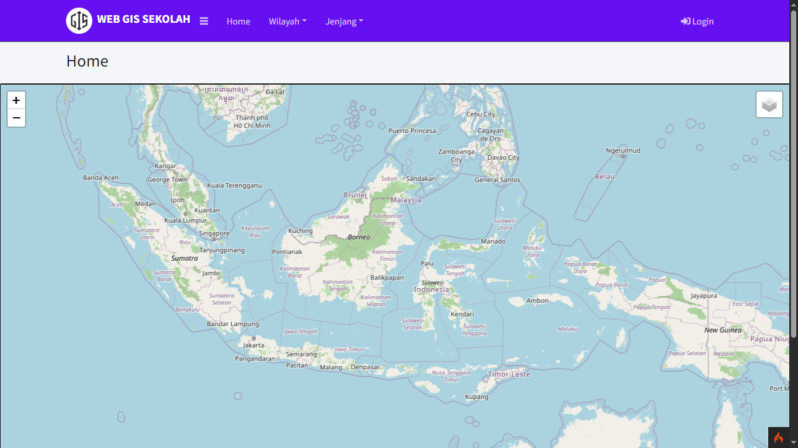
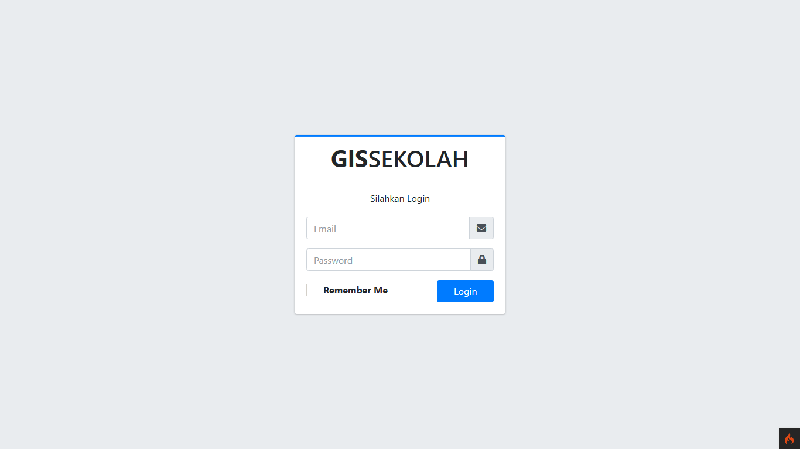
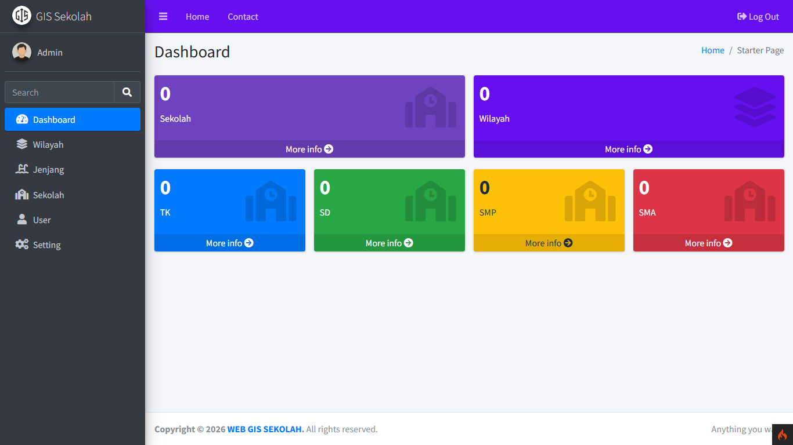

# 🗺️ Web GIS Sekolah - CodeIgniter 4

<p>
  
  
  
  
  
  
</p>

Proyek ini merupakan aplikasi Web GIS (Geographic Information System) untuk pendataan dan pemetaan lokasi sekolah, dibangun menggunakan framework **CodeIgniter 4** serta tampilan berbasis **AdminLTE**.

## ✨ Fitur Utama

- 🔐 Autentikasi Admin (Login & Logout)
- 📍 Pemetaan lokasi sekolah menggunakan Leaflet.js
- 🏫 Manajemen data sekolah (CRUD)
- 📊 Dashboard admin responsif dan modern
- 🧭 Penentuan koordinat lokasi secara interaktif di peta
- 📁 Upload gambar/foto sekolah

## 🛠️ Teknologi yang Digunakan

- [CodeIgniter 4](https://codeigniter.com/)
- [AdminLTE 3](https://adminlte.io/)
- [Leaflet.js](https://leafletjs.com/)
- PostgreSQL
- Bootstrap, jQuery, FontAwesome

## 📚 Referensi Pembelajaran

- [YouTube Playlist – Membangun Web GIS Sekolah Codeigniter 4 + Leaflet](https://youtube.com/playlist?list=PLYfaT5HP5yRrZa_MW_eQymabg4oKVq3D1&si=lx3skJM382Oww9II)
> Referensi utama dari seri pembelajaran di YouTube. Terima kasih kepada kreator konten atas ilmunya.

## 🚀 Cara Menjalankan Proyek

1. **Clone repositori**

   ```bash
   git clone https://github.com/pangeran-droid/WebGIS-Sekolah-CI4.git
   cd WebGIS-Sekolah-CI4
   ```

2. **Salin file `.env.example`**

   ```bash
   cp .env.example .env
   ```

3. **Edit konfigurasi database di `.env`**

   ```
   database.default.hostname = localhost
   database.default.database = nama_database
   database.default.username = nama_user
   database.default.password =
   database.default.DBDriver = Postgre
   database.default.port = 5432
   database.default.schema = public
   ```

   Isi `MAPBOX_ACCESS_TOKEN` di `.env` dengan token Mapbox jika ingin menggunakan layer peta Mapbox. Layer OpenStreetMap tetap tersedia tanpa token. Token yang digunakan browser akan terlihat oleh pengguna, jadi batasi token tersebut melalui pengaturan Mapbox.

   Pastikan ekstensi PHP `pgsql` dan `pdo_pgsql` aktif. Buat database PostgreSQL terlebih dahulu, lalu impor skema dan data:

   ```bash
   psql -U nama_user -d nama_database -f database/db_gis_sekolah_postgresql.sql
   ```

### Mengisi data melalui seeder

Seeder `GisSekolahSeeder` memasukkan atau memperbarui seluruh data dump berdasarkan primary key tanpa menghapus baris lain. Nilai password user dibaca dari dump lokal saat seeder dijalankan agar hash password tidak disimpan di source code.

Di PowerShell, arahkan `GIS_SEED_DUMP_PATH` ke file dump lalu jalankan:

```powershell
$env:GIS_SEED_DUMP_PATH = 'C:\path\to\db_gis_sekolah.sql'
& 'C:\xampp\php\php.exe' spark db:seed --class GisSekolahSeeder
```

4. **Jalankan server lokal**

   ```bash
   php spark serve
   ```

5. **Akses di browser**
   ```
   http://localhost:8080
   ```

## 🔑 Login Admin

Gunakan kredensial berikut untuk masuk sebagai admin:

- **Email**: `admin@gmail.com`
- **Password**: `admin123`

## 🧭 Struktur Proyek (Ringkasan)

```
/app
  ├── Controllers
  ├── Models
  ├── Views
  └── Config
/public
  └── AdminLTE/
/writable
.env
```

## 📌 Catatan

- Pastikan ekstensi PHP seperti `intl`, `curl`, `mbstring`, dan `openssl` aktif.
- Gunakan versi PHP minimal 7.4 atau lebih tinggi.
- Jika menggunakan XAMPP/Laragon, tempatkan folder proyek di `htdocs` atau `www`.

## 👁️ Pratinjau

`home`



***

`login`



***

`dashboard`



## 📄 Lisensi

Proyek ini dibuat untuk keperluan pembelajaran dan tugas kuliah. Bebas dimodifikasi sesuai kebutuhan.
